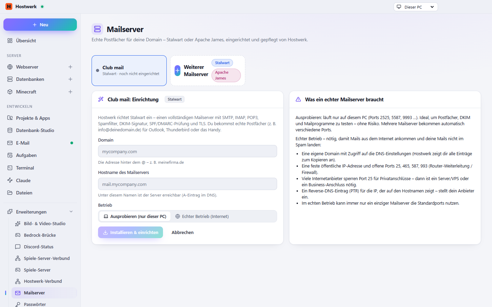

# Mailserver

Echte Postfächer mit eigener Domain: Stalwart oder Apache James – Einrichtung, Postfächer, DKIM/SPF/DMARC mit allen DNS-Einträgen zum Kopieren. Der Mail-Fänger zum Entwickeln bleibt in Hostwerk.

[English](README.md) · Offizielle [Hostwerk](https://github.com/Passimoritz/hostwerk-public)-Erweiterung (SDK 2.7, native Erweiterung)



## Was sie kann

- Zwei Programme zur Wahl, mit Vor- und Nachteilen
- Postfächer, Weiterleitungen und Testmail
- Alle DNS-Einträge (MX, SPF, DKIM, DMARC, Autoconfig) zum Kopieren, mit Zweck
- Mit der Erweiterung „DNS-Verwaltung“: Einträge per Klick beim DNS-Anbieter setzen – mit Vorschau, was schon steht, und Prüfung, ob sie draußen ankommen
- Sicherungen der Postfächer (jetzt sichern, zurückspielen – der aktuelle Stand wird vorher gesichert), auch in Hostwerks Sicherungs-Zentrale und in der externen Sicherung (ab Hostwerk 2.12)
- Umziehen auf einen anderen Rechner: Sicherung dort mit „Von einem anderen Rechner übernehmen“ einspielen
- „Kommen deine Mails an?“: Port 25 nach außen, Reverse-DNS der öffentlichen Adresse und bekannte DNS-Blacklists – mit dem, was zu tun ist, wenn etwas nicht stimmt
- Postfach-Passwörter direkt in den Passwort-Tresor (mit der Erweiterung „Passwörter“)
- Einstellungen fürs Mailprogramm
- Ports, die sich nie in die Quere kommen, Start mit Hostwerk
- Sicherheits-Updates für Stalwart: Patch-Versionen kommen mit Hostwerks Sicherheits-Updates – erst ausprobiert, bei einem Fehler bleibt die vorige Version (ab Hostwerk 2.11)

## Installieren

In Hostwerk unter **Erweiterungen → Entdecken** auf „Installieren“ klicken. Wer die Funktion schon in Hostwerk 2.8 benutzt hat, bekommt die Erweiterung beim Update automatisch – mit allen Daten.

Native Erweiterungen laufen als Teil von Hostwerk (eigener Server- und Oberflächen-Teil). Darum installiert Hostwerk sie nur aus dem offiziellen Katalog (mit Prüfsumme) oder im Entwickler-Modus.

## Daten

`settings.mailservers, data/mailserver`, Sicherungen in `data/mailserver-backups/<server>/` – genau dort, wo Hostwerk sie schon immer abgelegt hat. Entfernen der Erweiterung löscht nichts.

## Entwickeln

```bash
node --test tests/*.test.js          # Tests
node build-native.js .               # Oberfläche bauen (sdk/build-native.js aus hostwerk-public)
node check.js . --strict             # Prüfung wie im Katalog (sdk/check.js)
```

Quelltext der Oberfläche in `ui/src`, Server-Teil in `server/`. Texte im Code sind Englisch, Deutsch steht in `locales/de.json`.

## Lizenz

MIT
