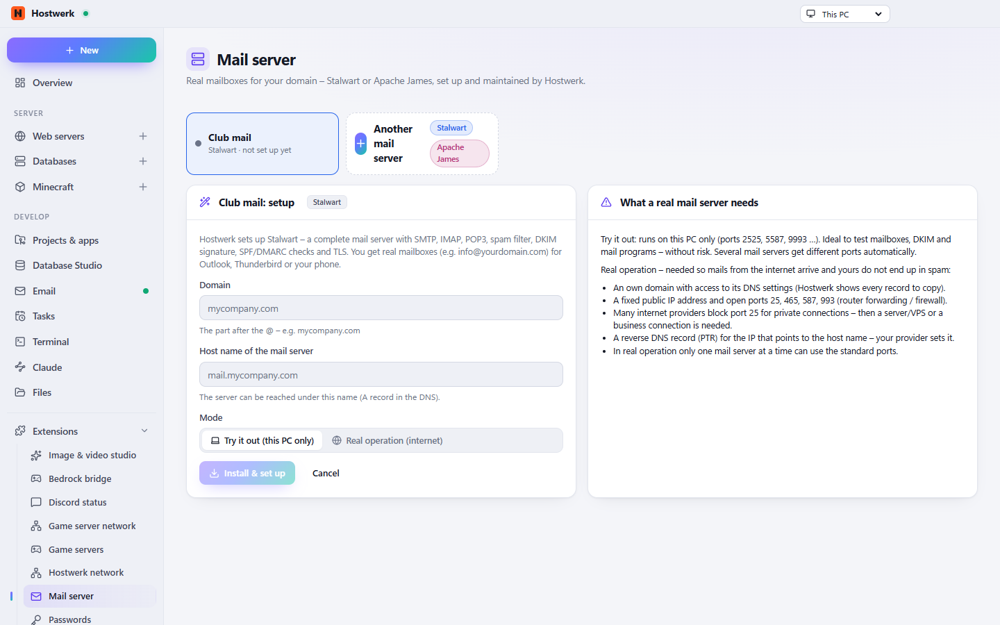

# Mail server

Real mailboxes with your own domain: Stalwart or Apache James – setup, mailboxes, DKIM/SPF/DMARC with every DNS record to copy. The mail catcher for development stays in Hostwerk.

[Deutsch](README.de.md) · An official [Hostwerk](https://github.com/Passimoritz/hostwerk-public) extension (SDK 2.7, native extension)



## What it does

- Two engines to choose from, with pros and cons
- Mailboxes, aliases and a test mail
- Every DNS record (MX, SPF, DKIM, DMARC, autoconfig) ready to copy, with what it is for
- Settings for the mail program
- Ports that never clash, start with Hostwerk
- Security updates for Stalwart: patch versions arrive with Hostwerk's security updates – tried out first, the previous version stays if the new one fails (Hostwerk 2.11 or newer)

## Install

In Hostwerk: **Extensions → Discover** and click “Install”. If you already used this feature in Hostwerk 2.8, the update installs the extension by itself – with all your data.

Native extensions run as part of Hostwerk (own server and interface part). That is why Hostwerk only installs them from the official catalogue (with checksum) or in developer mode.

## Data

`settings.mailservers, data/mailserver` – exactly where Hostwerk always kept it. Removing the extension deletes nothing.

## Develop

```bash
node --test tests/*.test.js          # tests
node build-native.js .               # build the interface (sdk/build-native.js from hostwerk-public)
node check.js . --strict             # same check as the catalogue (sdk/check.js)
```

Interface source in `ui/src`, server part in `server/`. Texts in the code are English, German is in `locales/de.json`.

## License

MIT
